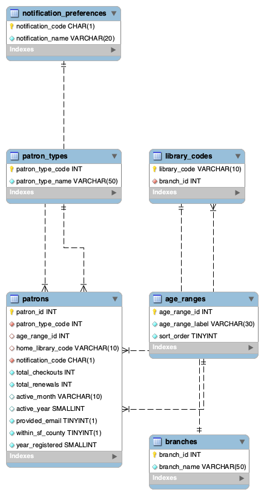

# Project Documentation

This project builds a MySQL database for the San Francisco Public Library's
patron usage data, along with Python scripts to load it and a terminal app to
search and edit it.

- **Data:** one Excel file from DataSF (437,115 patrons, 14 columns)
- **Database:** MySQL, designed as six normalized tables
- **Loading:** a Python script (pandas + mysql-connector-python)
- **App:** a menu-driven terminal program in Python
- **Results:** performance measurements and findings are in [results/README.md](../results/README.md)

## Project structure

| Folders / files | What's in the file |
|---|---|
| `scripts/schema.sql` | Creates the six tables |
| `scripts/load_data.py` | Reads the Excel file, cleans it, and loads all tables |
| `scripts/indexes.sql` | Adds two indexes used in the performance experiment |
| `scripts/queries.sql` | The eight analysis queries behind the findings |
| `scripts/explore_data.py`, `scripts/explore_more.py` | Data exploration done before designing the tables |
| `scripts/test_connection.py` | Checks that Python can connect to MySQL |
| `app/main.py` | The terminal app |
| `results/` | Timings, index experiment, findings, and query output as CSV files |
| `docs/` | This documentation, the ER diagram, and screenshots |
| `config.example.py` | Template for database login settings |
| `requirements.txt` | Python packages needed |

## How to set up and run the project

These steps rebuild the whole project from scratch on a MacBook Air. It's assumed
[Homebrew](https://brew.sh) and [Anaconda or Miniconda](https://docs.conda.io)
are installed.

### 1. Getting the code

```bash
git clone https://github.com/jay-kook/SFILS.git
cd SFILS
```

### 2. Installing and starting MySQL

```bash
brew install mysql
brew services start mysql
```

### 3. Creating the database

Log in to MySQL (`mysql -u root -p`, or open MySQL Workbench) and run:

```sql
CREATE DATABASE sfils;
```

### 4. Setting up Python

```bash
conda create -n sfils python=3.11 -y
conda activate sfils
pip install -r requirements.txt
```

### 5. Adding your database login

```bash
cp config.example.py config.py
```

Open `config.py` and enter your MySQL root password between the quotes. `config.py` is listed in `.gitignore`, so the
password is never uploaded publicly.

### 6. Downloading the dataset

The data file is not stored in this repository due to its size.
I would download it into a `data` folder:

```bash
mkdir data
curl -L -o data/library_usage.xlsx "https://data.sfgov.org/api/views/qzz6-2jup/files/ecfd0051-fe40-43c3-a17d-caeff0f1503f?download=true&filename=SFPL_DataSF_library-usage_Jan%202023.xlsx"
```

This is the file SFPL_DataSF_library-usage_Jan 2023.xlsx from the
[Library Usage dataset on DataSF](https://data.sfgov.org/Culture-and-Recreation/Library-Usage/qzz6-2jup).

### 7. Creating the tables

From the terminal:

```bash
mysql -u root -p < scripts/schema.sql
```

Or in MySQL Workbench: File -> Open SQL Script -> `scripts/schema.sql`, then run it. The script drops and recreates all six tables, so it can be rerun safely.

### 8. Loading the data

```bash
python scripts/load_data.py
```

This should take about a minute. It prints a row count for each table. The expected
counts are: patron_types 18, age_ranges 10, notification_preferences 4,
branches 30, library_codes 67, patrons 437,115. 

### 9. Adding the indexes

```bash
mysql -u root -p sfils < scripts/indexes.sql
```

### 10. Running the app

```bash
python app/main.py
```

The MySQL server must be running (step 2). To quit the app, choose option 7.

## Database design



The original spreadsheet is one flat table where text values like branch names
and patron types repeat hundreds of thousands of times. I normalized it into
one main table and five lookup tables:

| Table | Rows | Purpose |
|---|---|---|
| `patrons` | 437,115 | One row per patron: checkouts, renewals, activity, registration year, and foreign keys to the lookup tables |
| `patron_types` | 18 | Patron type code and name (Adult, Juvenile, Senior, ...) |
| `age_ranges` | 10 | Age range label, plus a `sort_order` column so age groups sort youngest to oldest |
| `notification_preferences` | 4 | Contact preference code and name (Email, Phone, Print, None) |
| `branches` | 30 | Each branch name, stored once |
| `library_codes` | 67 | Each library code and the branch it belongs to |

Key design decisions:

- **Two tables for libraries.** The data has about 67 library codes but only 30
  branch names (for example, Main has 4 codes and Bookmobile has 9). Storing
  codes in `library_codes` with a foreign key to `branchse` means each branch
  name is stored only once.
- **Codes as primary keys where the data provides them.** Patron types,
  notification preferences, and library codes already have unique codes in
  the data, so those codes are the primary keys. Age ranges and branches have
  no codes, so they use `AUTO_INCREMENT` IDs.
- **NULL for missing data.** 927 patrons have no age range, 2 have no library
  code, and 40,592 have no activity date. These are stored as `NULL` rather
  than filled in with guesses.
- **Foreign keys on every link**, so MySQL rejects any patron that points to
  a nonexistent type, age range, library code, or contact preference.

### Data cleaning in load_data.py

- The spreadsheet's column headers contained line breaks (for example,
  `Patron Type Code\npatron_type_code`), so the script keeps only the first
  line of each header.
- Text values are trimmed of extra spaces.
- Blank activity months were stored as empty text rather than missing values,
  so they are converted to `NULL`.
- The activity year was stored as a decimal (2022.0) because of missing
  values, so it is converted to a whole number.
- The notification code "-" has no name in the data, so it is stored with the
  name "None."
- Patrons are inserted in batches of 5,000 with `executemany` for speed.

## Using the app


| Option | What it does | SQL used |
|---|---|---|
| 1. Look up a patron | Shows one patron's details with readable names | `SELECT` with `JOIN` and `LEFT JOIN` |
| 2. Show branch statistics | Patron counts and average checkouts per branch, sortable | `SELECT` with `GROUP BY` |
| 3. Show top borrowers | The top 1-100 patrons by checkouts | `SELECT` with `ORDER BY` and `LIMIT` |
| 4. Add a new patron | Adds a patron, choosing from lists pulled from the lookup tables | `INSERT` |
| 5. Update a patron | Records new checkouts, or changes contact preference or patron type | `UPDATE` |
| 6. Delete a patron | Deletes a patron after showing their details and asking for confirmation | `DELETE` |
| 7. Quit | Exits the app | |


Design notes:

- **All user input goes through `%s` placeholders**, never pasted directly
  into SQL, to prevent SQL injection.
- **Sorting choices use a fixed list.** Column names can't be passed as
  placeholders, so option 2 maps the user's choice ("1" or "2") to SQL the
  program controls, instead of using what the user typed.
- **New patrons choose from lists** built from the lookup tables, so they
  can't break a foreign key. Since patrons store library codes rather than
  branches, a new patron gets their branch's shortest (main) code, such as
  `m6` for Mission.
- **Input is validated.** Typing letters where a number is expected asks
  again instead of crashing, and database errors are caught and shown as
  messages.
- **`LEFT JOIN` is used for nullable columns**, so patrons with a missing age
  range or library code still appear in lookups.

## What I learned

- **Normalization in practice.** Finding that 30 branches had 67 codes
  showed me why exploring the data before designing tables matters. A single
  libraries table would have repeated branch names, and splitting it into
  two tables fixed that.
- **Real data is messy.** Line breaks in column headers, blank strings that
  pandas didn't count as missing, and decimal years all had to be handled
  before loading. I also found 19 patrons with checkouts but no activity date,
  an inconsistency in the source data.
- **Indexes and EXPLAIN.** Adding indexes made two queries 12-14 times faster,
  and EXPLAIN showed why: MySQL switched from scanning every row to reading
  the index directly, and in both cases answered the query from the index
  alone. I also learned that MySQL automatically indexes foreign key columns.
- **JOIN vs. LEFT JOIN.** A regular JOIN silently drops rows with no match,
  which is fine for statistics but wrong for looking up a specific patron.
- **Safe SQL from Python.** Placeholders protect values, but not column names,
  which need a fixed list of allowed options.
- **Git and cloud-synced folders don't mix.** My repository was originally on
  my iCloud-synced Desktop, which caused Git to fail. Moving it to a local
  folder fixed it.

## Acknowledgments

- I used Claude AI throughout this assignment for
  step-by-step guidance on setting up MySQL and navigating Workbench with my computer and setting up the terminal app with the library dataset. Also used Claude in providing help and aid for understanding the code for MySQL. Also provided aid in debugging.